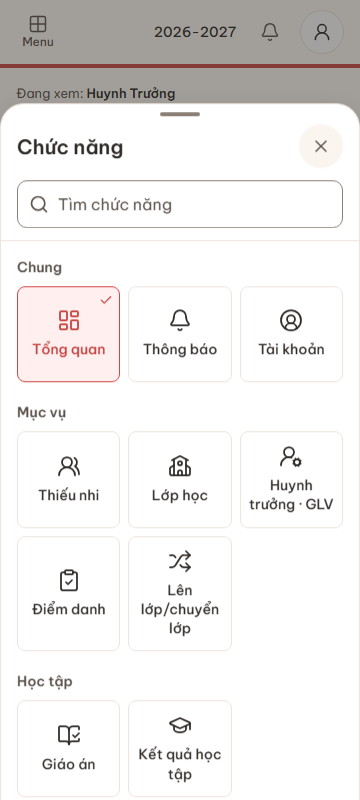
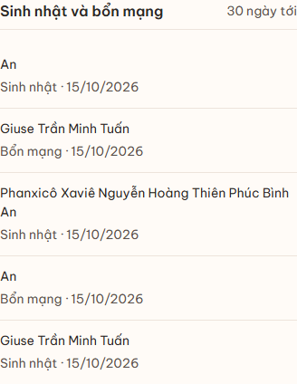
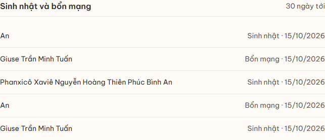

# MOBILE-NAV-GROUPS-20261014 — phản hồi ba ảnh mobile

Ngày: 14/10/2026. Phạm vi: dashboard và danh mục chức năng trong app shell.

## Đối chiếu vấn đề và cách sửa

| Vị trí | Trước | Sau |
|---|---|---|
| Trang chủ `/dashboard` | Khối “Tất cả chức năng” lặp lại menu, kéo dài trang | Gỡ khối danh mục khỏi nội dung dashboard |
| Sinh nhật/bổn mạng | `flex-wrap` khiến ngày nằm ngang hoặc xuống dòng tùy độ dài tên | Dưới 640px luôn tên trên, loại ngày/ngày tháng dưới; từ 640px dùng hai cột, tên dài được xuống dòng trong cột tên |
| Menu chức năng | Gộp mọi module vào một lưới, tách tài khoản/thông báo thành nhóm không tên | Nhóm Chung, Mục vụ, Học tập, Điều hành, Gia đình theo các mục được phép xem; không dựng nhóm rỗng |
| Menu đầy đủ trên desktop | Nút dẫn tới anchor cuối trang chủ | Mở cùng danh mục có nhóm trong dialog, giữ đường vào các module ít dùng |

Role có ít nhất hai nhóm thấy tiêu đề nhóm. Tìm kiếm theo tên chức năng hoặc danh mục, có hỗ trợ chữ không dấu; khi tìm kiếm còn một nhóm vẫn giữ tiêu đề để rõ ngữ cảnh. Thông báo và Tài khoản nằm trong Chung. Giáo án/Kết quả học tập nằm trong Học tập; hai mục phụ huynh nằm trong Gia đình.

## Thiết kế

Áp dụng skill `ui-ux-pro-max`: breakpoint nhất quán, ưu tiên điện thoại, thứ bậc thông tin và vùng chạm. Giữ font Be Vietnam Pro, token màu/ngành và kiểu bottom sheet hiện có. Ô menu dùng icon Lucide, tên đầy đủ, viền nhẹ và khoảng cách 8/12/20px; bỏ nền trang trí bên trong icon. Không thêm thư viện, palette hay module.

## Bảo toàn nghiệp vụ

| Luồng | Cách bảo toàn |
|---|---|
| Phân quyền menu | Lọc bằng `isItemVisible` trước khi chia nhóm; không đổi danh sách route được phép, server guard hoặc RLS |
| Lớp của tôi | Giữ resolver đích theo phân công/năm học; badge đọc qua module gốc |
| Điều hướng nhanh | Giữ các preset 5 mục theo role |
| Tài khoản | Giữ sheet tài khoản, hồ sơ, đổi mật khẩu, đăng xuất và khôi phục focus |
| Chức năng ít dùng | Có thể mở menu đầy đủ từ mọi trang, cả desktop lẫn mobile |
| Không JavaScript | Danh mục nằm trong `noscript`/`details` đóng mặc định, mở bằng “Menu chức năng”; không phụ thuộc anchor ở dashboard |
| Dữ liệu sinh nhật | Giữ truy vấn 30 ngày, giới hạn 10 dòng, cách định dạng ngày và quyền ẩn danh sách tên với Thủ quỹ |

Không migration, sửa dữ liệu nghiệp vụ, thay API/RLS/quyền hoặc dependency. E2E dùng Supabase local; fixture hình học dùng tên giả trong trình duyệt, không ghi hồ sơ thiếu nhi vào DB.

## File sản phẩm

- `src/app/(dashboard)/dashboard/page.tsx`
- `src/features/dashboard/components/dashboard-overview.tsx`
- `src/config/navigation.ts`
- `src/components/layout/mobile-menu-sheet.tsx`
- `src/components/layout/app-shell.tsx`
- `src/components/layout/app-sidebar.tsx`
- `src/components/layout/all-features-grid.tsx`
- `src/components/ui/bottom-sheet.tsx`

## Kiểm tra

- `npm run lint`: đạt, không warning/error ESLint.
- `npm run typecheck`: đạt.
- `npm test`: **2.028 pass / 24 skip**, 136 file pass / 6 skip.
- `npm run build` với `CQ_E2E_DIST_DIR=.next-r4-mobile-nav`: đạt, không thay bundle preview đang mở.
- Playwright cuối: **55 pass / 0 fail / 2 skip** trong 2,4 phút. 54 bài navigation bao phủ 14 role × 360/768/1366px, đường vào chức năng ít dùng, tìm kiếm/danh mục, tài khoản, rail/focus và menu không JavaScript. Một bài geometry chạy toàn bộ 12 độ rộng; hai bản sao của bài này ở project tablet/laptop bỏ qua có chủ đích.
- Fixture sinh nhật: 360/375/390/430/639/640/768/1024/1366/1440/1920/2560px, tên ngắn/dài, cả sinh nhật/bổn mạng; 0/1/5/20/100 dòng. Kiểm vị trí tên/ngày và không tràn ngang; dữ liệu thật vẫn giới hạn 10 dòng.
- Lượt browser đầu: **39 pass / 16 fail / 2 skip**; 15 lỗi do test so toàn bộ text link có badge với nhãn thuần, 1 lỗi do Playwright biến JSX thành descriptor khi render fixture SSR. Sửa harness để kiểm nhãn riêng và biên dịch JSX thật; không sửa logic sản phẩm để bỏ qua lỗi test.

## Giới hạn và bàn giao

**Đã phát hành ngày 14/10/2026:** source `c94386354fa7f24cff0615a0d5f9aa52c50515b7` đã push `main`; Vercel báo success đúng SHA. [Mở production](https://cq-tntt-manager-web.vercel.app). Smoke Chromium 360/1366px: HTTP 200, CSS responsive mới được phục vụ, không overflow/pageerror; dashboard chưa đăng nhập chuyển về login. Bằng chứng ở `verification/evidence/mobile-nav-20261014/production-deployment.json` và `production-results.json`.

Không đóng backlog R5–R13/UX-42/R13.3 hay coi toàn bộ E2E lịch sử đã xanh. Chưa kiểm Safari/iOS hoặc điện thoại thật; không submit authenticated CRUD trên production. Những thay đổi ngoài tám file sản phẩm nêu trên thuộc test và tài liệu tracking.

Theo yêu cầu mới của user 14/10, `AGENTS.md` §10, WORKLOG/D-55 và deployment runbook ghi bắt buộc tự kiểm tra → commit → push → xác nhận production sau mỗi task sửa code, không chờ hỏi lại. Rollback bản UI bằng revert source `c943863`, không cần rollback dữ liệu.

## Ảnh kiểm tra

Ảnh sinh nhật dùng dữ liệu mẫu cho kiểm tra bố cục; ảnh menu dùng tài khoản local.

